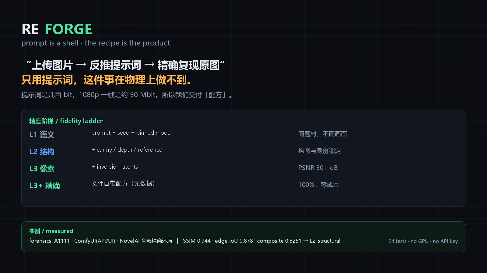
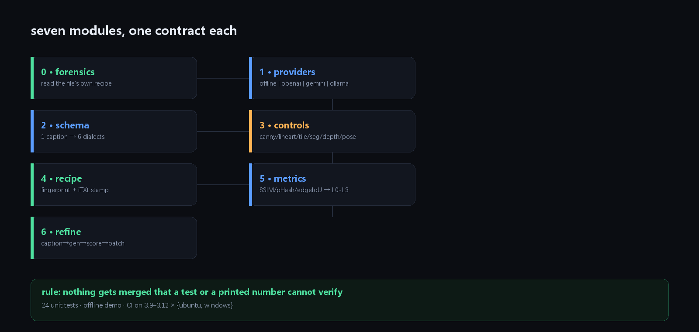

# REFORGE

**Reverse-engineer any AI image or video into a *reproducible recipe* — not just a prompt.**

[](tests/)
[](pyproject.toml)
[](LICENSE)
[](#quickstart)
[](README.zh-CN.md)



---

## The uncomfortable truth this repo is built on

"Upload a picture, get its prompt, regenerate the exact picture" **cannot work with prompts alone.**

A caption is a few hundred bits of text. A 1080p frame is ~50 Mbit. Every prompt-based
reverse-engineering tool on GitHub — including the good ones — sits at the same ceiling:
*semantically similar*, never *the same image*.

REFORGE does not pretend otherwise. It gives you the four things that actually get you to
pixel-level reproduction, in order of cost:

| Tier | What you ship | How | What you get |
|---|---|---|---|
| **L0** | — | nothing | drift |
| **L1** semantic | prompt + seed + pinned checkpoint | caption model | same idea, different picture (SSIM ~0.3–0.5) |
| **L2** structural | \+ control maps + reference image | canny/depth/seg, IP-Adapter, reference-only | same layout & identity, new pixels (SSIM 0.6–0.85) |
| **L3** pixel | \+ inversion latents + exact sampler pins | DDIM / RF-Solver inversion (`reforge invert`) | PSNR 30+ dB |
| **L3+** exact | the file already carried its recipe | **read the metadata** | 100%, free, instant |

So REFORGE is built in that order:

1. **Read first.** PNG `tEXt`/`iTXt`, EXIF, ComfyUI graphs, NovelAI blobs, C2PA — most AI files
   leak their own creation parameters. Recovered exactly, with per-field provenance and confidence,
   before spending a single GPU cycle.
2. **Caption second.** Pluggable VLM backends (offline heuristic · any OpenAI-compatible ·
   Gemini · Ollama) all answer in one strict JSON contract, so dialects, scoring and the refine
   loop never care which model you used.
3. **Lock structure third.** Extract canny / lineart / tile / GrabCut-seg / depth in-process;
   drop in an ONNX model or wire your own CLI for pose, flow, camera. Approximations are labelled
   `approximate` and can never silently claim to be real depth.
4. **Stamp the recipe into the file fourth.** `reforge:recipe` as an `iTXt` chunk. The file
   carries its own reconstruction instructions from then on. *This is the only honest answer to
   "same prompt must reproduce the same image."*
5. **Split video into shots.** One prompt per timeline always fails; a video recipe is a list of
   shot recipes, each anchored to its own first frame, each separately verifiable.
6. **Prove it.** A closed loop: `caption → compile → generate → score → critique → patch`,
   with model-free metrics (PSNR, SSIM, pHash, edge IoU, palette Δ) so "reproducible" is
   measurable instead of vibes.

No GPU needed to use any of this. No API key needed either — `offline` is the default.

---

## Quickstart

```bash
git clone https://github.com/zhangbotong92-cyber/reforge && cd reforge
pip install -e .          # only needs numpy + pillow

reforge demo              # generates fixtures, runs all six stages, prints proof
```

```
[1/6] forensics
  a1111.png      png via automatic1111 - recovered: cfg, clip_skip, denoising, loras,
                 model, model_hash, negative, prompt, sampler, seed, steps, tool_version
  comfyui.png    png via comfyui - recovered: cfg, controls, loras, model, seed, steps ...
  novelai.png    png via novelai - recovered: cfg, negative, prompt, sampler, seed ...
  plain.jpg      jpeg 512x512 - no embedded recipe (caption needed)
  doctor: canny=builtin, lineart=builtin, tile=builtin, seg=builtin, depth=builtin, pose=none

[2/6] recipe + stamp      fidelity=L1-reproducible seed=1234567890 model=sd_xl_base_1.0
                          stamp round-trip: OK

[3/6] caption + dialects  6 platforms compiled from one caption contract

[4/6] fidelity score      composite=0.8251 grade=L2-structural ssim=0.944 edge_iou=0.878

[5/6] control signals
  [ok]   canny     builtin
  [ok]   seg       builtin  (approximate)
  [ok]   depth     builtin  (approximate)
  [skip] pose      'pose' unavailable. Place pose.onnx in ~/.cache/reforge/models ...

[6/6] video: shot-split + per-shot recipe
  frames via frames-dir: 3 shots (512x512)
  shot 0: 主体：... ；运动：缓慢推近
  recipe: 3 shots, 1 identity anchors, fidelity=L2-structural
```

> Needs `pip >= 22` and `setuptools >= 64` (both standard since 2022). On an older toolchain:
> `python setup.py develop`, or just `PYTHONPATH=. python -m reforge demo` — the package is
> importable with no install step at all.

---

## What you can actually do

### Forensics — read the file's own recipe (exact, free)

```bash
reforge inspect a1111.png --json
```

A1111 / Forge / SD.Next parameter blocks, ComfyUI **API graphs** (link-following through
`positive`/`negative`/`model`/`latent_image`, so LoRAs and ControlNet/IPAdapter nodes are
recovered too), ComfyUI UI workflows (low-confidence fallback), NovelAI `Comment`, InvokeAI
`sd-metadata`, PNG `tEXt/zTXt/iTXt`, EXIF `UserComment`, XMP `parameters=`, MP4 `udta/ilst`, C2PA
detection. Every field carries `{source, confidence}` — if it cannot name the source, it is not
in `recovered`.

### Controls — real maps, honest labels

```bash
reforge doctor                       # capability matrix for this machine
reforge controls img.png --outdir ctl
```

| kind | backend | what it is | honest? |
|---|---|---|---|
| `canny` | builtin (cv2) | Canny edges | real |
| `lineart` | builtin (cv2) | cleaned + thickened contours | real |
| `tile` | builtin | Lab-L luminance tile | real |
| `seg` | builtin (cv2 GrabCut) | foreground mask | **approximate** |
| `depth` | builtin | dark-channel prior (He et al. 2009) | **approximate** |
| `depth` | `~/.cache/reforge/models/depth.onnx` | Depth-Anything-V2 or any ONNX | real |
| `pose` | `pose.onnx` or `REFORGE_CTL_POSE` | DWPose / RTMPose | real |
| `flow` / `camera` | command | RAFT / VGGT | real |

Three escape hatches, no magic: `builtin` → `onnx` (drop a file in the model dir, optional
`depth.json` for shape/mean/std) → `REFORGE_CTL_DEPTH='python run.py --img {image} --out {out}'`.
`doctor` tells you which one will fire; `extract` raises with the exact upstream URL when none can.

### Video — shots, not a timeline

```bash
reforge video clip.mp4 --dialect kling --out video.recipe.json
reforge video --frames-dir frames/ --max-shots 6     # works with no ffmpeg at all
```

Scene detection → per-shot keyframe → per-shot caption → per-shot dialect → recipe with
`shots[]`, each pinned to a `first_frame`, plus a plan for Wan2.2-VACE / FLF2V pipelines and four
rules that stop identity drift. `video.score_video(a, b)` averages the frame metrics and reports
the worst frame and a stability number.

### Inversion — the L3 tier is executable, not aspirational

```bash
reforge invert                         # prove the numerics: no checkpoint, no GPU, ~1s
reforge invert img.png --model stabilityai/stable-diffusion-2-1 \
        --prompt "a lighthouse at dusk" --recipe r.json --out latents.npz
```

The solver is model-agnostic: feed it a velocity field (rectified flow: FLUX, SD3, Wan) or
an epsilon predictor (DDIM: SD1.5 / SDXL). `--self-test` asserts it against fields with
closed-form solutions, and reports **two different claims** instead of one fuzzy number:

```
constant field : max|err| 4.4e-16  (exact, any step count)
taylor (2nd)   : rel err   1.1e-03  convergence x3.92 per halving
euler  (1st)   : rel err   3.3e-02
ddim algebra   : rel err   2.2e-17  (exact with an oracle eps)
ddim predicted : rel err   2.7e-02  (the inherent gap null-text inversion fixes)
```

That last line is the honest part: DDIM inversion with a *predicted* epsilon is inexact by
construction, and the residual compounds with step count — which is exactly why null-text
inversion exists and why second-order RF solvers matter. The worker encodes both, and
`--recipe` promotes a recipe file to `L3-pixel` once latents exist.

**Measured on a real checkpoint** (`nota-ai/bk-sdm-tiny`, CPU, `DDIMScheduler`, 20 steps, 320 px)
— see [docs/inversion.md](docs/inversion.md):

| guidance | inversion PSNR | VAE ceiling | gap |
|---|---|---|---|
| 1.0 | 16.40 dB | 31.56 dB | 15.2 |
| 3.0 | 14.32 dB | 31.56 dB | 17.2 |
| 7.5 | 11.35 dB | 31.56 dB | 20.2 |

The gap tracks the CFG scale monotonically — the known failure mode, reproduced on demand, so the
implementation is behaving like a DDIM inversion should. A 0.5 B distilled model cannot reach the
30 dB bar: `passes_l3=false`, `quality="L3-approximate"`, and the metric says so out loud.
Closing it needs null-text refinement (backprop, GPU) or a rectified-flow checkpoint.

### Caption backends

| spec | endpoint | key from |
|---|---|---|
| `offline` | none, no network | — |
| `deepseek:deepseek-flash` | `api.deepseek.com` | `DEEPSEEK_API_KEY` |
| `openai:gpt-4.1-mini` | `api.openai.com` | `OPENAI_API_KEY` |
| `gemini:gemini-2.5-flash` | `googleapis.com` | `GEMINI_API_KEY` |
| `ollama:qwen2.5vl` | localhost | — |
| anything OpenAI-compatible | `REFORGE_BASE_URL` (provider `openai`) | `REFORGE_API_KEY` |

Reasoning models (DeepSeek flash and friends) put their work in `reasoning_content` and return an
empty `content` if `max_tokens` is tight — the adapter raises a clear error instead of parsing "".

Real output from `deepseek-flash` on the fixture (confidence **0.85**, vs 0.55 offline; it even
OCR'd the banner text):

```
summary : Flat graphic asset: a beige outlined circle centered over a diagonal rainbow gradient
          of green, magenta, blue and red, with a dark charcoal text banner at the bottom
          reading "REFORGE fixture".
camera  : flat orthographic full-frame graphic / none / straight-on
tags    : gradient background, diagonal stripes, beige circle, black outline, dark banner, ...
```


```bash
reforge score original.png regen.png
reforge refine img.png --generator-kind command \
        --generator "python examples/gen_stub.py --prompt-file {prompt_file} --out {out}"
```

`composite` = SSIM 0.35 · edge IoU 0.25 · pHash 0.20 · palette 0.15 · PSNR 0.05, graded
`L3-pixel ≥0.90`, `L2-structural ≥0.75`, `L1-semantic ≥0.55`, else `L0-drift`. The refine loop
keeps the best round and records every prompt/score/critique so a failure is inspectable.



---

## CLI

```bash
reforge inspect  img.png                 # what the file already knows (with provenance)
reforge caption  img.png --provider openai:gpt-4o-mini --dialects sd,flux,mj,kling,jimeng
reforge recipe   img.png --controls --out r.json --embed stamped.png --sidecar
reforge controls img.png --outdir ctl --kinds canny,lineart,tile,seg,depth,pose
reforge doctor                           # what this machine can extract, and what is one download away
reforge video    clip.mp4 --frames-dir frames/ --dialect kling --out video.json
reforge invert   img.png --model stabilityai/stable-diffusion-2-1 --prompt "..."   # L3 latents
reforge score    original.png regen.png [--json]
reforge refine   img.png --generator-kind command --generator "..."
reforge serve                            # local Web UI at 127.0.0.1:8770
reforge demo                             # full offline proof, six stages
```

### Library

```python
from reforge import forensics, providers, controls, recipe, schema, metrics, video

report = forensics.inspect("a1111.png")
print(report["recovered"]["seed"], report["tool"])

cap = providers.build_captioner("offline").caption("plain.jpg")
print(schema.compile_prompt(cap, "kling")["prompt"])

ctl = controls.extract_all("plain.jpg", "ctl")          # real png maps on disk
rec = recipe.from_inspection(report)
recipe.embed_into_png("a1111.png", "stamped.png", rec)  # the file carries its recipe now
assert recipe.read_embedded("stamped.png")["prompt"] == rec["prompt"]

print(metrics.score_pair("a1111.png", "alt.png")["composite"])
```

## Web UI + Space

`reforge serve` starts a **stdlib-only** server; the front end is one HTML file, no build, no
framework, no CDN. Drag or paste an image → forensics table with provenance → six dialects →
recipe JSON → **stamp into PNG** → extract control maps as a gallery → a **分镜** tab that turns
a frame sequence into per-shot recipes. A second drop zone scores any regeneration live.

`spaces/` contains the same library behind a Gradio shell for Hugging Face Spaces (no GPU, no key).

---

## What a recipe looks like

```json
{
  "schema": "reforge.recipe/1",
  "fidelity": "L2-structural",
  "prompt": "a cinematic portrait of an astronaut standing in a neon rainstorm, 85mm",
  "negative": "blurry, lowres, watermark",
  "sampling": {"seed": 1234567890, "steps": 28, "cfg": 6.5, "sampler": "DPM++ 2M Karras"},
  "models":  [{"role": "base", "name": "sd_xl_base_1.0", "hash": "31e35c80fc", "pinned": true}],
  "adapters":[{"kind": "lora", "name": "film_grain", "hash": "8f2b1c"}],
  "controls":[{"kind": "canny", "model": "cv2.Canny", "path": "ctl/canny.png", "weight": 0.6},
              {"kind": "depth", "model": "DCP proxy", "path": "ctl/depth.png",
               "weight": 0.3, "approximate": true}],
  "refs":    [{"path": "a1111.png", "weight": 0.55, "role": "identity"}],
  "init":    {"method": "rf-solver", "latents": "latents.npz"},
  "shots":   [{"index": 0, "start": 0, "end": 2.4, "prompt": "...", "first_frame": "shot_000.png"}],
  "fingerprint": "3bd8b70755a39dfa"
}
```

`fingerprint` hashes only the parts that decide pixels: same fingerprint ⇔ same intended output.
`validate()` lists what is still missing to climb the ladder; `controls.plan()` turns the recipe
into a concrete ComfyUI / diffusers / API node list.

---

## Who this is for

- **Creators** who want to rebuild a look they saw, not approximate it.
- **Dataset builders** who need (image, prompt, seed, controls) tuples instead of loose captions.
- **Pipeline engineers** who are tired of "it looked better yesterday" and want pinned recipes.
- **Provenance / forensics people** who need to know whether a file still carries its own recipe.

## What it is not

- Not a model. It orchestrates models.
- Not a promise of magic. Tier L1 is a caption; tier L3 needs inversion latents.
- Not a scraper. It reads files you give it.

## Built on

Every component is either stdlib/Pillow/OpenCV or a clearly-labelled adapter for an upstream
project — see [UPSTREAM.md](UPSTREAM.md) for the full bill of materials, licenses, and exactly
which part of each is used. Nothing was vendored; nothing is claimed as ours.

## Docs

- [ARCHITECTURE.md](ARCHITECTURE.md) — module contracts, data flow, extension points
- [UPSTREAM.md](UPSTREAM.md) — the assembly bill of materials
- [ROADMAP.md](ROADMAP.md) — what lands next (inversion worker, ComfyUI nodes, benchmark)
- [CONTRIBUTING.md](CONTRIBUTING.md)

## Community

- [Code of Conduct](CODE_OF_CONDUCT.md) · [Security policy](SECURITY.md) · [Contributing](CONTRIBUTING.md)
- Bugs and new-format requests: the issue templates ask the three questions that matter
  (reproducer, version, acceptance check).
- Design questions: [Discussions](https://github.com/zhangbotong92-cyber/reforge/discussions).
- If you ship this into a product, [CITATION.cff](CITATION.cff) has the reference entry.

## License

MIT. Do whatever you want; a star and a link back are appreciated.
