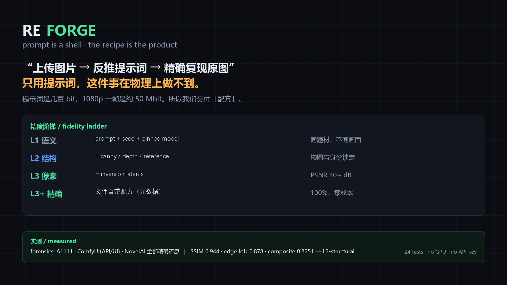
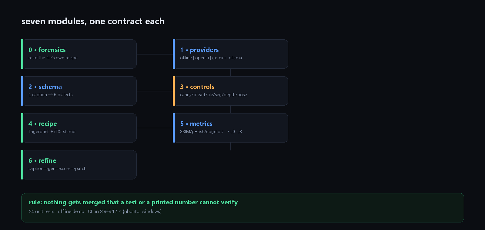

# REFORGE · 把任何 AI 图片/视频逆向成**可复现配方**

[English](README.md) | **简体中文**

[](tests/)
[](pyproject.toml)
[](LICENSE)
[](#快速开始)



---

## 先说一句不讨喜的真话

“用户传一张图，我们反推出提示词，用户拿提示词就能**精确**生出同一张图”——**只用提示词，这件事在物理上做不到**。

提示词是几百 bit 的文本，1080p 一帧是约 50 Mbit。GitHub 上所有“图生提示词”项目（包括做得最好的那几个）
天花板都一样：**语义相似**，永远不是**同一张图**。

所以 REFORGE 不吹这个牛，而是按“真正能做到精确”的顺序，把四档精度全给你：

| 档位 | 交付 | 手段 | 结果 |
|---|---|---|---|
| **L1 语义** | prompt + seed + 锁死模型 | 视觉反推 | 同题材，不同画面（SSIM 0.3–0.5） |
| **L2 结构** | \+ 控制图 + 参考图 | canny/深度/分割、IP-Adapter、reference | 构图与身份锁定（SSIM 0.6–0.85） |
| **L3 像素** | \+ 反演 latent + 采样器全锁 | DDIM / RF-Solver 反演（`reforge invert`） | PSNR 30+ dB |
| **L3+ 精确** | 文件本来就带配方 | **先读元数据** | 100%，零成本，秒出 |

这就是本项目的全部设计顺序：

1. **先读，再猜。** PNG `tEXt`/`iTXt`、EXIF、ComfyUI 图 JSON、NovelAI blob、C2PA——绝大多数 AI
   文件自己就漏了全部生成参数。逐个字段带**来源与置信度**精确还原，一分钱算力都不花。
2. **读不到才反推。** 反推后端全可插拔（离线启发式 · 任意 OpenAI 兼容 · Gemini · Ollama），
   统一输出严格 JSON 契约，后面的方言编译、闭环打分完全不在乎你用的哪家模型。
3. **结构必须外挂。** 进程内直接抽 canny / lineart / tile / GrabCut 分割 / 深度；姿态、光流、
   相机位姿走 ONNX 或你自己的命令行。**近似算法一律标 `approximate`**，永远不准冒充真深度。
4. **配方随文件走。** 把配方以 `iTXt` 块 `reforge:recipe` 盖回 PNG。从此这个文件自带重建说明。
   *“同一提示词必须复现同一张图”的唯一工程解，就是这个。*
5. **视频先拆镜。** 整段视频一条 prompt 必然崩；视频配方 = 一组镜头配方，每镜锚定自己的首帧，各自可验收。
6. **能验收。** `反推 → 编译 → 生成 → 打分 → 复审 → 修正` 闭环，配无模型依赖的指标
   （PSNR / SSIM / pHash / 边缘 IoU / 调色板 Δ），让“可复现”变成可测量的数字，而不是感觉。

全程**不需要 GPU**，也**不需要 API Key**（默认离线后端）。

---

## 快速开始

```bash
git clone https://github.com/zhangbotong92-cyber/reforge && cd reforge
pip install -e .          # 只依赖 numpy + pillow

reforge demo              # 生成测试素材，跑通六个阶段并打印证据
```

```
[1/6] forensics           ← 取证：文件自己说了什么
  a1111.png      png via automatic1111 - recovered: cfg, clip_skip, denoising, loras,
                 model, model_hash, negative, prompt, sampler, seed, steps, tool_version
  comfyui.png    png via comfyui - recovered: cfg, controls, loras, model, seed, steps ...
  novelai.png    png via novelai - recovered: cfg, negative, prompt, sampler, seed ...
  plain.jpg      jpeg 512x512 - no embedded recipe (caption needed)
  doctor: canny=builtin, lineart=builtin, tile=builtin, seg=builtin, depth=builtin, pose=none

[2/6] recipe + stamp      ← 配方 + 盖章进文件
  fidelity=L1-reproducible seed=1234567890 model=sd_xl_base_1.0   stamp round-trip: OK

[3/6] caption + dialects  ← 一份契约编译出六家方言

[4/6] fidelity score      ← 复现度校验
  composite=0.8251 grade=L2-structural ssim=0.944 edge_iou=0.878

[5/6] control signals     ← 真抽控制图
  [ok]   canny     builtin
  [ok]   seg       builtin  (approximate)
  [ok]   depth     builtin  (approximate)
  [skip] pose      'pose' unavailable. Place pose.onnx in ~/.cache/reforge/models ...

[6/6] video               ← 拆镜 + 每镜配方
  frames via frames-dir: 3 shots (512x512)
  recipe: 3 shots, 1 identity anchors, fidelity=L2-structural
```

> 需要 `pip >= 22` + `setuptools >= 64`（2022 年后的标配）。工具链太老就：
> `python setup.py develop`，或者干脆 `set PYTHONPATH=.` 后直接 `python -m reforge demo`——
> 这个包不装也能跑。

---

## 你实际能拿到什么

### ① 取证：读文件自己的配方（精确、免费）

```bash
reforge inspect a1111.png --json
```

支持 A1111 / Forge / SD.Next 参数块、ComfyUI **API 图**（沿 `positive`/`negative`/`model`/
`latent_image` 追链，所以 LoRA、ControlNet、IPAdapter 节点也能还原）、ComfyUI UI workflow
（低置信兜底）、NovelAI `Comment`、InvokeAI `sd-metadata`、PNG 三种文本块、EXIF
`UserComment`、XMP `parameters=`、MP4 `udta/ilst`、C2PA 探测。每个字段都带
`{来源, 置信度}`——说不出出处的值，不允许进 `recovered`。

### ② 控制信号：真出图，且诚实标注

```bash
reforge doctor                       # 这台机器的能力矩阵
reforge controls img.png --outdir ctl
```

| 信号 | 后端 | 是什么 | 诚实度 |
|---|---|---|---|
| `canny` | builtin (cv2) | Canny 边缘 | 真实 |
| `lineart` | builtin (cv2) | 清理加粗的线稿 | 真实 |
| `tile` | builtin | Lab-L 亮度瓦片 | 真实 |
| `seg` | builtin (cv2 GrabCut) | 前景掩膜 | **近似** |
| `depth` | builtin | 暗通道先验（He et al. 2009） | **近似** |
| `depth` | `~/.cache/reforge/models/depth.onnx` | Depth-Anything-V2 或任意 ONNX | 真实 |
| `pose` | `pose.onnx` 或 `REFORGE_CTL_POSE` | DWPose / RTMPose | 真实 |
| `flow` / `camera` | command | RAFT / VGGT | 真实 |

三级逃生口，没有魔法：`builtin` → `onnx`（丢个模型文件进目录，可选 `depth.json` 配
shape/mean/std）→ `REFORGE_CTL_DEPTH='python run.py --img {image} --out {out}'`。
`doctor` 告诉你哪一级会生效，`extract` 在都不行时直接抛出上游安装地址。

### ③ 视频：拆镜，而不是一条时间线

```bash
reforge video clip.mp4 --dialect kling --out video.recipe.json
reforge video --frames-dir frames/ --max-shots 6     # 没有 ffmpeg 也能跑
```

场景切分 → 每镜关键帧 → 每镜反推 → 每镜方言 → 产出带 `shots[]` 的配方，每镜锚定
`first_frame`，并附 Wan2.2-VACE / FLF2V 执行计划与四条防身份漂移铁律。
`video.score_video(a, b)` 给出逐帧均值、最差帧和稳定性。

### 反演：L3 这档是真能跑的，不是画饼

```bash
reforge invert                         # 验证数值：不要权重、不要 GPU，1 秒
reforge invert img.png --model stabilityai/stable-diffusion-2-1 \
        --prompt "a lighthouse at dusk" --recipe r.json --out latents.npz
```

求解器与模型无关：给它速度场（rectified flow：FLUX / SD3 / Wan）或 eps 预测（DDIM：SD1.5 / SDXL）
都行。自检报告**两个不同的结论**，而不是一个含糊分数：

```
常速度场  : 最大误差 4.4e-16   （精确，与步数无关）
taylor 二阶: 相对误差 1.1e-03   每减半步数误差降 3.92 倍
euler  一阶: 相对误差 3.3e-02
ddim 代数 : 相对误差 2.2e-17   （给 oracle eps 时精确）
ddim 预测 : 相对误差 2.7e-02   （DDIM 固有误差，正是 null-text 要修的东西）
```

最后一行是最诚实的地方：DDIM 用**预测的** eps 反演，本身就不精确，且残差随步数累积——这正是
null-text inversion 存在的理由，也是二阶 RF 求解器的价值。worker 把两条路都写进去了；
`--recipe` 会在有 latent 之后把配方升级成 `L3-pixel`。

**真实 checkpoint 实测**（`nota-ai/bk-sdm-tiny`，CPU，DDIM 调度器，20 步，320px），
详见 [docs/inversion.md](docs/inversion.md)：

| guidance | 反演 PSNR | VAE 上限 | 差距 |
|---|---|---|---|
| 1.0（无 CFG） | 16.40 dB | 31.56 dB | 15.2 |
| 3.0 | 14.32 dB | 31.56 dB | 17.2 |
| 7.5 | 11.35 dB | 31.56 dB | 20.2 |

差距随 guidance 单调变大——这就是业界公认的失败模式，被我们按需复现，说明实现行为正确。
0.5B 的蒸馏小模型到不了 30 dB 这条线：`passes_l3=false`、`quality="L3-approximate"`，
指标会自己说出来。要补上这个差距需要 null-text 精修（反传，要 GPU）或换成 rectified-flow 权重。

### 反推后端

| spec | 端点 | key 来源 |
|---|---|---|
| `offline` | 不联网 | — |
| `deepseek:deepseek-flash` | `api.deepseek.com` | `DEEPSEEK_API_KEY` |
| `openai:gpt-4.1-mini` | `api.openai.com` | `OPENAI_API_KEY` |
| `gemini:gemini-2.5-flash` | `googleapis.com` | `GEMINI_API_KEY` |
| `ollama:qwen2.5vl` | 本机 | — |
| 任意 OpenAI 兼容 | `REFORGE_BASE_URL`（provider 写 `openai`） | `REFORGE_API_KEY` |

推理模型（如 DeepSeek flash）会把内容放进 `reasoning_content`，`max_tokens` 给小了 `content` 就是空；
适配器会直接报清楚的错，而不是去解析一个空串。

`deepseek-flash` 对 fixture 的真实输出（置信度 **0.85**，离线只有 0.55，连 banner 上的字都 OCR 出来了）：

```
summary : Flat graphic asset: a beige outlined circle centered over a diagonal rainbow gradient
          of green, magenta, blue and red, with a dark charcoal text banner at the bottom
          reading "REFORGE fixture".
camera  : flat orthographic full-frame graphic / none / straight-on
tags    : gradient background, diagonal stripes, beige circle, black outline, dark banner, ...
```


```bash
reforge score original.png regen.png
reforge refine img.png --generator-kind command \
        --generator "python examples/gen_stub.py --prompt-file {prompt_file} --out {out}"
```

`composite` = SSIM 0.35 · 边缘 IoU 0.25 · pHash 0.20 · 调色板 0.15 · PSNR 0.05，评级
`L3-pixel ≥0.90`、`L2-structural ≥0.75`、`L1-semantic ≥0.55`，否则 `L0-drift`。
闭环保留最优轮与每轮 prompt/分数/复审意见，失败可复盘。



---

## 命令行

```bash
reforge inspect  img.png                 # 这个文件已经知道什么（带来源标记）
reforge caption  img.png --provider openai:gpt-4o-mini --dialects sd,flux,mj,kling,jimeng
reforge recipe   img.png --controls --out r.json --embed stamped.png --sidecar
reforge controls img.png --outdir ctl --kinds canny,lineart,tile,seg,depth,pose
reforge doctor                           # 这台机器能抽什么，差什么、差多远
reforge video    clip.mp4 --frames-dir frames/ --dialect kling --out video.json
reforge invert   img.png --model stabilityai/stable-diffusion-2-1 --prompt "..."   # L3 latent
reforge score    original.png regen.png [--json]
reforge refine   img.png --generator-kind command --generator "..."
reforge serve                            # 本地 Web UI：http://127.0.0.1:8770
reforge demo                             # 六阶段离线全链路
```

### 作为库用

```python
from reforge import forensics, providers, controls, recipe, schema, metrics, video

report = forensics.inspect("a1111.png")
print(report["recovered"]["seed"], report["tool"])

cap = providers.build_captioner("offline").caption("plain.jpg")
print(schema.compile_prompt(cap, "kling")["prompt"])

ctl = controls.extract_all("plain.jpg", "ctl")           # 真落盘的 PNG 控制图
rec = recipe.from_inspection(report)
recipe.embed_into_png("a1111.png", "stamped.png", rec)   # 文件从此自带配方
assert recipe.read_embedded("stamped.png")["prompt"] == rec["prompt"]

print(metrics.score_pair("a1111.png", "alt.png")["composite"])
```

## Web UI + Space

`reforge serve` 起的是**纯标准库**服务，前端单文件 HTML，无构建、无框架、无 CDN。
拖入/粘贴图片 → 带来源的取证表 → 六家方言 → 配方 JSON → **盖进 PNG** → 一键抽控制图（画廊）
→ “分镜”页把一串帧变成逐镜配方；左下角第二个拖拽区实时给复现度打分。

`spaces/` 里是同一套库的 Gradio 壳，可直接挂 Hugging Face Space（无 GPU、无 Key）。

---

## 一份配方长什么样

```json
{
  "schema": "reforge.recipe/1",
  "fidelity": "L2-structural",
  "prompt": "a cinematic portrait of an astronaut standing in a neon rainstorm, 85mm",
  "negative": "blurry, lowres, watermark",
  "sampling": {"seed": 1234567890, "steps": 28, "cfg": 6.5, "sampler": "DPM++ 2M Karras"},
  "models":  [{"role": "base", "name": "sd_xl_base_1.0", "hash": "31e35c80fc", "pinned": true}],
  "adapters":[{"kind": "lora", "name": "film_grain", "hash": "8f2b1c"}],
  "controls":[{"kind": "canny", "model": "cv2.Canny", "path": "ctl/canny.png", "weight": 0.6},
              {"kind": "depth", "model": "DCP proxy", "path": "ctl/depth.png",
               "weight": 0.3, "approximate": true}],
  "refs":    [{"path": "a1111.png", "weight": 0.55, "role": "identity"}],
  "init":    {"method": "rf-solver", "latents": "latents.npz"},
  "shots":   [{"index": 0, "start": 0, "end": 2.4, "prompt": "...", "first_frame": "shot_000.png"}],
  "fingerprint": "3bd8b70755a39dfa"
}
```

`fingerprint` 只对“决定像素”的字段做哈希：指纹相同 ⇔ 期望输出相同。
`validate()` 告诉你离下一档还差什么，`controls.plan()` 直接给 ComfyUI / diffusers / API 的节点清单。

---

## 适合谁

- **创作者**：想复刻看到的画面，而不是“大概像”。
- **数据集建设者**：要的是 (图, prompt, seed, 控制信号) 元组，不是一段散文。
- **管线工程师**：受够了“昨天还好好的”，想把配方钉死。
- **取证/溯源**：判断一个文件是否还带着自己的生成参数。

## 不适合谁 / 不做什么

- 它不是模型，是调度器。
- 它不承诺魔法：L1 就是文案，L3 需要反演 latent。
- 它不抓站，只处理你给的文件。

## 站在谁的肩膀上

每个组件要么是标准库/Pillow/OpenCV，要么是对上游项目的**明确标注的适配层**。
完整清单（含许可证、用了哪一部分）见 [UPSTREAM.md](UPSTREAM.md)。没有内嵌任何第三方代码，
也没有把别人的成果说成自己的。

## 文档

- [ARCHITECTURE.md](ARCHITECTURE.md) — 模块契约、数据流、扩展点
- [UPSTREAM.md](UPSTREAM.md) — 拼装清单（Bill of Materials）
- [ROADMAP.md](ROADMAP.md) — 反演 worker、ComfyUI 节点、benchmark
- [CONTRIBUTING.md](CONTRIBUTING.md)

## 社区

- [行为准则](CODE_OF_CONDUCT.md) · [安全策略](SECURITY.md) · [贡献指南](CONTRIBUTING.md)
- 报 bug / 要新格式：直接用 issue 模板，它只问三件关键的事（复现、版本、验收标准）。
- 设计讨论：[Discussions](https://github.com/zhangbotong92-cyber/reforge/discussions)。
- 要引用到论文或产品里：[CITATION.cff](CITATION.cff) 里有现成条目。

## License

MIT。随便用，给个 star 和回链就行。
